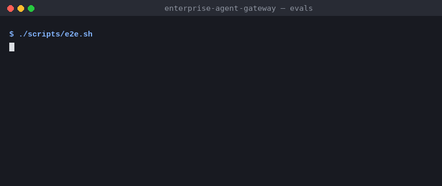
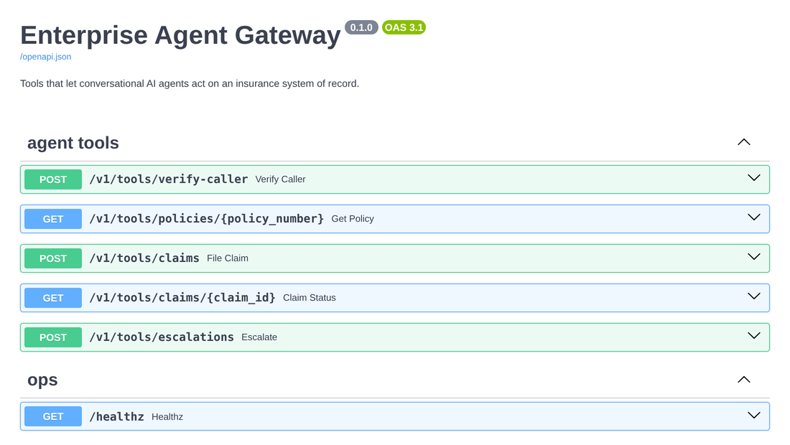

# enterprise-agent-gateway

A voice or chat agent that sounds good in a demo still has to verify the caller, read the right policy, file a claim exactly once and never repeat a card number back to the model. This repository is the integration layer that makes that safe for an insurance contact center.



## What's in here

| Path | What it does |
| --- | --- |
| `gateway/` | **FastAPI** service that exposes the system of record as agent tools: caller verification, policy lookup, claim filing, claim status and human handoff. |
| `mcp-server/` | **TypeScript** **MCP** server that publishes those tools to any MCP-capable agent runtime over stdio. |
| `mcp-server/evals/` | Scripted conversations replayed through the real MCP server against a live gateway. They run in CI. |



## Design decisions

- **The model never holds credentials.** `verify_caller` returns a short-lived, HMAC-signed caller session. The MCP server keeps it per conversation and only gives the model a masked display name. A session is bound to tenant and policy, so a token issued for one policy can't read another policy or its claims.
- **Retries don't create duplicates.** Agents retry. Write tools take an `Idempotency-Key`, backed by Redis `SET NX` with a TTL. The MCP server derives the key from the conversation id and a hash of the arguments, so a repeated `file_claim` replays the original claim. If the operation fails, the key is released so a genuine retry still works.
- **PII stays out of storage and logs.** Free text from the caller is redacted before it is persisted: emails, IBANs, Luhn-checked card numbers and phone numbers. The audit log records tenant, agent, route, status and latency for every tool call, and never the payload. The end-to-end test asserts this.
- **Errors are written for the agent.** Gateway errors come back as `code: message` tool errors, for example `not_covered: glass on 2026-01-20 is not covered by this policy`. The model can then explain the outcome or escalate, instead of guessing.
- **Ports and adapters.** Use cases in `services/` depend only on protocols in `ports.py`. MongoDB/Redis and in-memory adapters are interchangeable, which keeps unit tests fast and lets the service run with zero infrastructure.

```
agent runtime ──MCP/stdio──▶ mcp-server ──HTTP + API key──▶ gateway ──▶ MongoDB (policies, claims, escalations)
                                │                              └──▶ Redis (idempotency keys)
                                └─ caller sessions, idempotency keys, input validation (zod)
```

## Tech stack

- Python 3.12, FastAPI, Pydantic v2, Motor (MongoDB), redis-py, Uvicorn
- TypeScript, Node.js 22, Model Context Protocol SDK, zod
- pytest, vitest, ruff, mypy (strict), tsc (strict)
- Docker, Docker Compose, GitHub Actions

## Running it

### With Docker

```bash
docker compose up --build
curl localhost:8080/healthz
```

### Locally, without any infrastructure

The gateway falls back to in-memory adapters and demo data when `GATEWAY_MONGO_URL` is not set.

```bash
cd gateway
python -m venv .venv && . .venv/bin/activate
pip install -e ".[dev]"
uvicorn gateway.main:create_app --factory --port 8080
```

Open <http://localhost:8080/docs> to try the tools. Demo caller: policy `HH-100234`, date of birth `1987-04-12`, API key `demo-key`.

### Connecting an agent

```bash
cd mcp-server && npm ci && npm run build
```

```json
{
    "mcpServers": {
        "insurance-tools": {
            "command": "node",
            "args": ["/path/to/mcp-server/dist/index.js"],
            "env": { "GATEWAY_URL": "http://localhost:8080", "GATEWAY_API_KEY": "demo-key" }
        }
    }
}
```

## Tests

```bash
cd gateway && ruff check . && mypy && pytest     # unit, API contract and end-to-end conversation tests
cd mcp-server && npm run typecheck && npm test    # MCP tools through an in-memory client
./scripts/e2e.sh                                  # boots the gateway and replays the scenario evals
```

## Configuration

| Variable | Default | |
| --- | --- | --- |
| `GATEWAY_API_KEYS` | `demo-key:acme-insurance:voice-agent` | Comma-separated `key:tenant:agent` entries |
| `GATEWAY_SESSION_SECRET` | `change-me` | HMAC secret for caller sessions |
| `GATEWAY_SESSION_TTL_SECONDS` | `900` | Caller session lifetime |
| `GATEWAY_IDEMPOTENCY_TTL_SECONDS` | `86400` | How long write results are replayable |
| `GATEWAY_MONGO_URL` | unset | MongoDB connection string; in-memory when unset |
| `GATEWAY_REDIS_URL` | unset | Redis connection string for idempotency keys |
| `GATEWAY_SEED_DEMO_DATA` | `true` | Upsert the demo policies on startup |

## License

MIT
